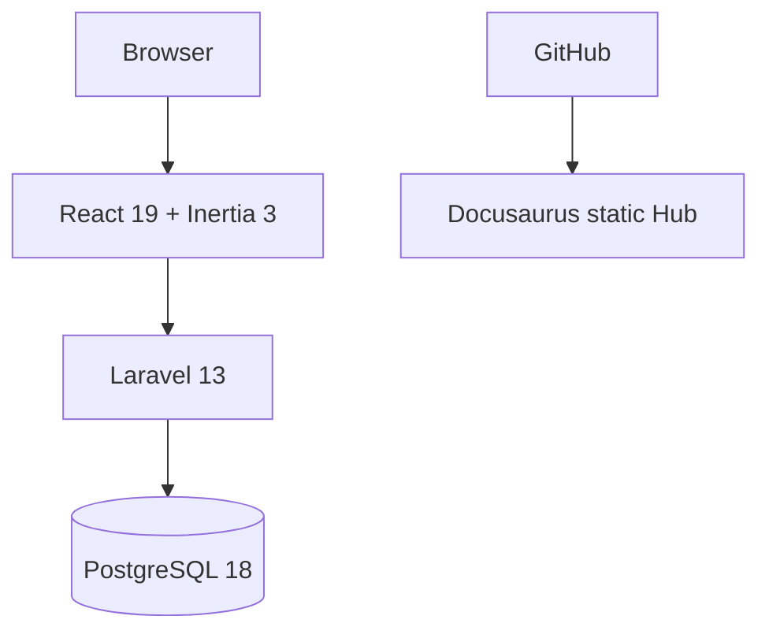

# Architecture

Target architecture (approved stack; not a verified deployment).

The Hub has no separate database or authentication. The application owns music entities, credits and provenance. GitHub Issues and Milestones own delivery status; the Hub presents a read-only snapshot. No API or preview deployment is approved yet.
