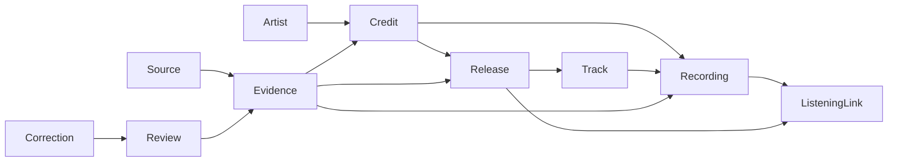

# Integrated music domain requirements

Approved product concept, not an approved physical schema, ERD, implementation task or source-rights grant. R0 runnable foundation comes first. Later issues must carry executable acceptance and obtain applicable scope approval.

## Core domain contracts

| ID | Entity / capability | Required behavior |
| --- | --- | --- |
| MUS-01 | Artist | Stable identity, names/aliases, linked releases and credited contributions; distinguish primary and contributing roles. Group membership and additional relationship types require R1 definition. |
| MUS-02 | Release | Distinguish release metadata and edition; ordered tracklist references recordings; reciprocal appearances on recording pages. Edition grouping rules pending. |
| MUS-03 | Recording | Stable identity distinct from release track position; duration/identifiers optional when unknown; link to artists, releases, credits and sources. |
| MUS-04 | Credits | Contributor, role, credited target and evidence; navigate in both directions. Do not infer a specific role solely from a general recording source. |
| MUS-05 | Provenance | Citation identifies exact assertion or relationship, source, locator and applicable rights/verification state. Display attribution and uncertainty; missing or disputed evidence is not verified. |
| MUS-06 | Listening | Selected recording and verified official external URLs, provider and target association; unavailable fallback; no actual playback status without provider evidence. Embeds deferred. |
| MUS-07 | Corrections | Public proposal references stable target and suggested change/evidence; input validation, abuse protection and privacy; no public registration. Submission cannot change public data directly. |
| MUS-08 | Internal review | Compare proposed and current values, inspect evidence/rights, record decision, reason and actor; acceptance distinct from publication. Server authorization and concurrency handling required. |
| MUS-09 | Search | Search public approved entities and aliases; link exact identity, respect visibility; usable empty/error states. |
| MUS-10 | Data quality | Validate relationships, required fields, duplicates and links; flag missing evidence and broken references without fabricating facts. Advanced merge, automation and taxonomy tooling need separate scope. |

## Conceptual relationships

Track is a release placement, not a synonym for Recording. Work (composition) versus Recording (realization), contributor identities, group membership, label and edition hierarchy are R1 decisions; no standalone Work module approved yet. Diagram indicates conceptual associations, not cardinalities or physical schema.

## Integrity and access

Use stable IDs and reciprocal links; do not duplicate facts across screens. Unknown metadata remains unknown. Evidence must attach to the actual claim, with source rights reviewed before real ingestion. Keep sensitive source material and reviewer/private submitter information out of public views and public repository. Validate official URL scheme/host and provider target server-side; avoid arbitrary iframe/HTML and unsafe network fetches. No real source or provider is approved by this document.

Draft, review decision and published state must be distinct. Publishing requires authorized actor and eligible evidence/rights. Exact roles, lifecycle states, transaction boundaries, audit retention and rollback policy require R1 review. No deletion or merge automation is authorized. Use synthetic fixtures only.

## End-to-end acceptance scenarios for future feature issues

- MUS-01–05: a fixture recording appears in two releases; each ordered track links back to the same recording; contributor credit and source citation refer to the exact claim and allow reciprocal navigation without implying unsupported credits.
- MUS-06: select recording, navigate to its contributor and back; selection persists; only validated official link is actionable; missing links are unavailable; no embed, playback timer, audio request or autoplay.
- MUS-07–08: submit correction against exact target; review sees proposed/current values and evidence; unauthorized actor cannot decide/publish; decision reason and actor are traceable; public record stays unchanged until authorized publication; stale edit is detected.
- MUS-09–10: search returns matching public entities, not drafts; missing or conflicting data is clearly indicated; duplicate candidates are flagged rather than automatically merged.
- All: desktop/mobile, keyboard, accessible naming, long Vietnamese names, error/empty states, server validation and relevant regression tests.

These are requirements and scenario references, not passed tests or authorization to implement all modules in R0.

## Approved Product Blueprint direction

Existing MUS-01–10 remain the MVP contract, including selected-recording Listening Panel and verified external links only. The following additions are approved for requirements/backlog preparation, not automatic implementation or new MVP authorization.

| ID | Capability | Scope boundary |
| --- | --- | --- |
| MUS-11 | Music Connections | Reciprocal credit/release links within current scope; inferred similarity, group networks and richer discovery require later issue approval. |
| MUS-12 | Music Identity & Version Explorer | Work/Recording/Release/Track vocabulary and version identity review in R1; standalone Work and version explorer deferred pending scope and schema approval. |
| MUS-13 | Vietnamese Search & Knowledge | Candidate acceptance for MUS-09: accents, aliases, Unicode and exact identity; wider Vietnam-specific taxonomy/content strategy subject to rights and issue approval. |
| MUS-14 | SEO & Discoverability | Candidate public-feature acceptance: canonical URL, accurate titles/metadata, public-only sitemap, no draft indexing; implementation approval per issue. |
| MUS-15 | Music Timeline | Future direction, derived only from sourced dated events with date precision; not MVP expansion. |

Complete Credits maps to MUS-04, Universal Listening Links to MUS-06, Trust Center and Data Quality to MUS-05/10. No new providers, integrations, dedicated trust module or automated duplicate merge authorized. See [business rules](./business-rules.md), [data dictionary](./data-dictionary.md) and [synthetic acceptance scenarios](./synthetic-scenarios.md). Product success hypotheses: search task success, claim evidence coverage, valid official link coverage and correction turnaround; define denominators and privacy before instrumentation. No analytics service approved.
