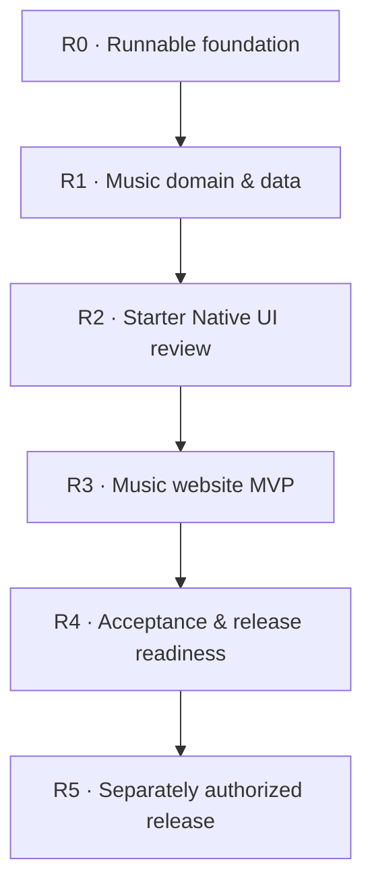
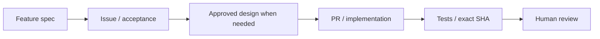

# Product-first recovery plan

The Music Website is the primary deliverable. Docusaurus is a supporting static documentation surface, not a project-management product. GitHub remains the sole source of truth. See [operating rules](https://github.com/fusumivietnam/muzik-os/blob/main/AGENTS.md) and [R0 issue #1](https://github.com/fusumivietnam/muzik-os/issues/1) for actionable acceptance and live status.

| Gate | Deliverable and evidence |
| --- | --- |
| R0 | Official starter revision, committed genuine lockfiles, PostgreSQL migrations/tests, disabled public registration, integrated CI and static docs build; exact PR SHA for review. |
| R1 | Domain vocabulary, Artist/Release/Recording/Track/Work/Credit relationships, search and corrections rules, provenance and source-rights policy; synthetic fixtures. Schema requires review. |
| R2 | Review UI directly on integrated starter; preserve upstream tokens; responsive and accessibility states; human acceptance before baseline. |
| R3 | Deliver vertical slices for Home, Search, Artist, Release, Recording, credits, provenance, official listening links and Listening Panel, corrections/internal review and legal; test each slice. |
| R4 | Aggregate product, design, regression, accessibility, security, data and release readiness evidence. Checks occur in each feature PR, not only here. |
| R5 | Human acceptance and separate authorization to merge/deploy as applicable; deployment evidence required. |

This is a sequence of gates, not a live status table or committed calendar. R0 scope is approved; subsequent feature execution requires its applicable scope and design approvals. No real ingestion or public API in R0. Do not expand the Hub before the Music Website foundation is verified.

## Evidence chain

Use [live issues](https://github.com/fusumivietnam/muzik-os/issues), [pull requests](https://github.com/fusumivietnam/muzik-os/pulls) and [Actions](https://github.com/fusumivietnam/muzik-os/actions). A closed issue is not proof of deployment. No estimated completion percentages.

## Review references

Apply [OWASP ASVS](https://owasp.org/www-project-application-security-verification-standard/) controls proportionate to risk and target [WCAG 2.2](https://www.w3.org/TR/WCAG22/) AA for public UI (target, not certification). Use official Laravel and GitHub documentation; record applicable versions and controls in acceptance when implemented. Do not expose sensitive security findings in the public Hub.
